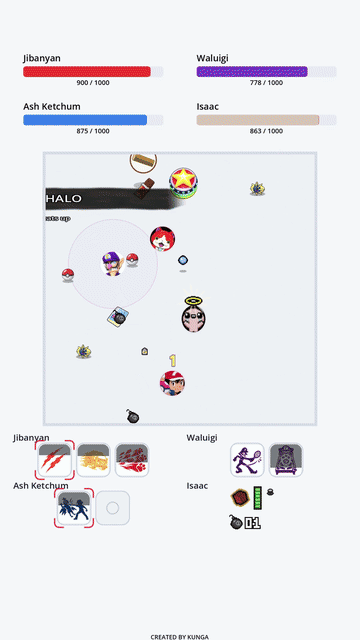

# AI Game Maker Portfolio

Codex와 게임을 만들며 어떤 규칙을 정했고, 실제 플레이를 보고 무엇을 바꿨는지 정리한 포트폴리오입니다.

## MYGOATmatch

여러 캐릭터의 특징을 스킬·이동·판정 규칙으로 옮겨 대결시키는 2D 탑뷰 자동전투 게임입니다. 경기를 관전하고, 저장한 리플레이를 9:16 전투 영상 제작에 활용합니다.

**개인 프로젝트 · 2026.08–현재 · Godot 4 / C# · Windows · 개발 중**

**제가 맡은 일** 
전투 규칙과 스킬 발동 조건, 연출 순서를 정했습니다. 직접 경기를 돌려 결과를 보고 다음 수정을 결정했습니다.

**Codex에 맡긴 일** 
기존 코드 조사, 지정한 범위의 구현·수정, 회귀 테스트 작성.

[시즌 2 전투 영상](https://www.instagram.com/p/Dey872nMY9Q/)

### AI와 작업하는 방식

> 문제 재현 → 영향 범위 확인 → 변경·유지 조건 지정 → Codex 구현 → 정적 확인·빌드 → 실제 플레이 → 다음 수정 범위 결정

 

### 대표 기술 판단

| 기술 문제 | 내가 내린 결정 |
| --- | --- |
| 미래 위치 예측으로 연속 공격 연결 | 상대가 밀리는 동안 도착점을 계산해, 넉백이 끝날 때 다음 공격자가 준비 위치에 있도록 했습니다. |
| 상태별 피해·누적·해제 규칙 분리 | 지정된 스킬로 멈추거나 돌진하면 피해는 적용하고 누적 효과 증가는 막되 타이머는 계속 흐릅니다. 특정 상태 전환 시 기존 효과를 초기화합니다. |
| 공용 전투 상태와 전용 표시의 책임 분리 | 변신은 상대의 장착 기술과 전투 로직을 재사용하고, 외형과 HUD는 변신 단계에 맞춰 전환하게 했습니다. |
| 판정·상태 전이·VFX를 별도로 확인 | 질주 히트박스를 표시해 화면 크기와 비교하도록 하고, 다운 발동 시점과 총공격 연출을 따로 점검했습니다. |

[기술 사례 4편](docs/MYGOATMATCH_CASE.md) · [Codex 작업 방식](docs/AI_WORKFLOW.md)

## 다른 프로젝트

### Website Escape Game

가상의 브라우저에서 여러 페이지를 탐색하며 단서와 아이템을 모아 탈출하는 웹게임입니다.

**개인 프로젝트 · 3일 제작 · React / TypeScript / Canvas · GitHub Pages 배포**

Codex와 탐색부터 엔딩까지 연결했습니다. 축구 미니게임에서 공이 양 팀 선수 사이를 반복해 오가자, 동시 접근을 경합으로 처리하고 킥 직후 재접촉을 막았습니다.

[바로 플레이](https://mindarinda47.github.io/website-escape-game/) · [제작 사례](docs/WEBSITE_ESCAPE_CASE.md)

### 붐비(Boombi) · AI 활용 설계 사례

**개인 프로젝트 · TypeScript / React · 공모전 제출 완료**

부산 혼잡 예보 서비스의 행사 공지는 모델이 구조화하고, 혼잡 점수와 추천 순서는 규칙 엔진이 계산합니다. 모델 응답이 검증에 실패하면 규칙 기반 결과를 반환합니다.

[설계 사례](docs/BOOMBI_CASE.md) · [공개 코드](https://github.com/Mindarinda47/boombi-ai-crowd-forecast)

## Game Programming Foundation

**Unity 2D RPG Gameplay Systems** · Unity / C# · 개인 프로젝트 
NPC 대화·퀘스트·인벤토리·전투·저장과 불러오기를 하나의 플레이 흐름으로 연결했습니다.

**VR Disaster Simulation** · Unity / C# / Netcode for GameObjects / XR · 3인 팀 
PC Host–VR Client 연결, 플레이어 생성·소유권 이전·위치 동기화와 관제 기능을 맡았습니다.

[Game Programming Portfolio](https://github.com/Mindarinda47/game-programming-portfolio)
