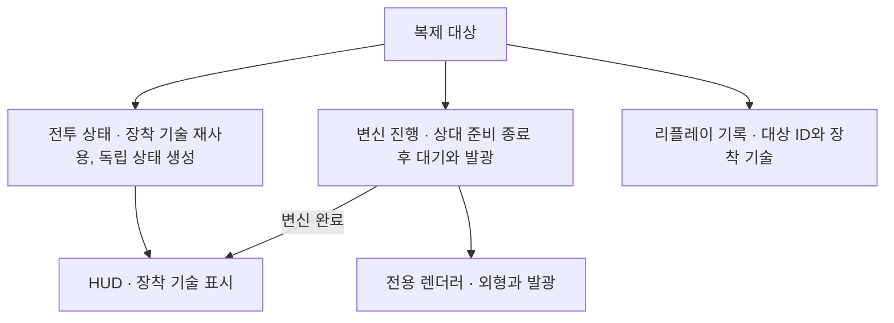

# MYGOATmatch — 자동 전투에서 내린 기술 판단

[포트폴리오](../README.md) · [Codex 작업 방식](AI_WORKFLOW.md) · [시즌 2 전투 영상](https://www.instagram.com/p/Dey872nMY9Q/)

Godot·C#으로 만드는 Windows용 2D 자동 전투 프로젝트입니다. 저는 전투 규칙을 정하고 실제 경기를 돌려 봅니다. Codex에는 문제와 관련된 코드를 찾아 제가 정한 조건에 맞게 수정해 달라고 했습니다.

## 1. 미래 위치 예측으로 연속 공격 타이밍 개선

나루토의 분신 콤보에서 기존 구현은 상대가 넉백을 마친 뒤에 다음 분신을 출발시켰습니다. 그때부터 상대의 현재 위치를 쫓으면 넉백과 다음 공격 사이에 이동 시간이 한 번 더 들어갔습니다. 제가 정한 기준은 **넉백이 끝나는 순간, 다음 공격자가 이미 준비 위치에 있을 것**이었습니다.

기존의 잡기 → 준비 → 타격 순서를 기준으로 두고, Codex에는 다음 공격자의 출발 시점과 접근 로직을 고치도록 했습니다. 상대의 넉백 방향과 남은 시간으로 도착점을 예측하고, 경기장 벽에서 반사될 때도 그 위치를 계산에 넣었습니다. 다음 공격자는 넉백 중에 출발하고, 타격은 넉백이 끝난 뒤 처리합니다. 피해와 넉백은 기존 공격 처리를 따릅니다.

이후 플레이에서 공격 전 대기가 길고 도착 직후 급정지하는 모습이 어색해, 준비 시간과 감속을 각각 조정했습니다. 리플레이는 경기 중 기록한 공격자의 좌표를 사용합니다.

## 2. 상태에 따라 피해·누적 효과 증가·해제 조건 분리

경기 중 스킬을 쓰는 상대에게 공격을 연달아 맞혀도 효과가 더 쌓이지 않는 경우가 있었습니다. 다른 경기에서는 상대가 궁극기에 들어간 뒤 이전 효과가 남았습니다. 두 상황을 확인한 뒤, 새 적중과 기존 효과의 해제 조건을 아래처럼 따로 정했습니다.

| 상태 | 피해 | 누적 효과 증가 | 기존 타이머 | 효과 초기화 |
| --- | --- | --- | --- | --- |
| 일반 적중 | 기존 피해 판정 | 조건 충족 시 증가 | 진행, 새 누적 시 갱신 | — |
| 대상이 특정 스킬로 멈춰 있거나 돌진할 때 | 현재 누적 단계 기준으로 일반 피해 판정 | 차단 | 계속 진행 | — |
| 특정 궁극기 진입 | — | — | 기존 일반 누적 효과의 타이머 종료 | 해당 효과와 시각 표시 제거 |

Codex는 공격과 경기장 장치 접촉에 같은 누적 제한을 적용하고, 초기화는 궁극기 진입 시점에 연결했습니다. Codex가 작성한 회귀 테스트는 시전 중 피해와 타이머 진행, 시전 후 누적 재개를 확인합니다.

## 3. 공용 전투 상태와 전용 표시의 책임 분리

메타몽의 변신 외형 위에 기본 캐릭터의 이동 방향선이 겹쳤고, 상대의 준비동작에서 변신으로 넘어가는 간격도 짧았습니다. 스크린샷을 공유하며 공용 전투 로직은 유지하고, 표시 분기와 변신 타이밍을 수정해 달라고 했습니다.

Codex는 변신 외형에 기본 방향선이 겹치던 분기를 고치고, 상대 준비가 끝난 뒤 대기 시간을 뒀습니다. 리플레이는 저장한 대상 ID와 장착 기술을 읽어 변신 순서와 HUD 전환을 재현합니다.

## 4. 판정·상태 전이·VFX를 별도로 확인

퀸의 궁극기는 탑승체로 돌진해 상대를 공격한 뒤 폭발로 이어지는 기술입니다. 경기에서 탑승체가 상대를 지나갔는데도 공격이 잘 맞지 않는 것처럼 보였습니다. 화면에서 보이는 크기와 실제 타격 범위를 비교하려고 히트박스를 먼저 표시해 달라고 했습니다.

1. **접촉 범위.** 코드에서는 탑승체를 키운 뒤에도 판정 범위가 작게 남아 있었습니다. Codex는 캡슐형 히트박스의 크기를 보정하고, 실제 경기와 리플레이에서 타격 범위와 이동 경로를 표시하도록 했습니다.
2. **상대가 쓰러지는 시점.** 질주로 다운 누적치가 상한에 도달해도 상대는 후속 기술의 마지막 폭발이 적중할 때 쓰러지도록 정했습니다. 폭발 도중의 반복 피해는 이 누적치에 더하지 않습니다.
3. **총공격 연출.** 점프할 때 균열이 생기고, 초상에 반사광이 들어올 때 파편이 움직이도록 지정했습니다. Codex는 기존 총공격의 경과 시간과 난수 시드를 사용해 이 순서대로 재생되도록 구현했습니다. 피해가 적용되는 시점은 기존 값을 사용합니다.

캐릭터와 원작 IP의 권리는 각 권리자에게 있으며, 이 문서는 개인 프로젝트의 개발 과정과 기술적 판단을 소개합니다.
